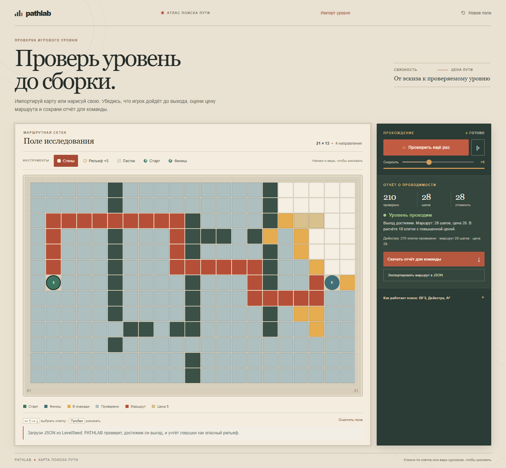

# PATHLAB

Check a game level before implementation: verify reachability, estimate route cost, and export a review-ready report.

## Русский

PATHLAB помогает дизайнеру уровня проверить карту до сборки игры: импортируйте сетку из LevelSeed или нарисуйте свою, проверьте путь от старта до выхода и оцените его цену с учётом сложного рельефа. Сохраните отчёт Markdown для команды и JSON маршрута для игрового прототипа. Сравнение BFS, Дейкстры и A* доступно отдельно, когда нужно понять, почему меняется путь.

### Возможности

- Сравнение BFS, Дейкстры и A* на одной карте.
- Рисование стен и дорогого рельефа, перемещение старта и финиша.
- Пошаговый или автоматический запуск с паузой и настройкой скорости.
- Переключение между движением по четырём и восьми направлениям.
- Сравнение числа проверенных клеток, длины и реальной стоимости каждого найденного маршрута.
- Сохранение найденного маршрута, препятствий и дорогих клеток в JSON для прототипа игры или проверки навигации.
- Скачивание отчёта проверки в Markdown: проходимость, условия движения, стоимость маршрута или число недостижимых клеток.
- Проверка по умолчанию использует Дейкстру и учитывает цену рельефа; в отчёте есть вердикт, длина, стоимость и координаты маршрута.
- Координаты JSON отсчитываются от левого верхнего угла с нуля.
- Управление с клавиатуры: стрелки выбирают клетку, пробел применяет выбранный инструмент, `Ctrl/Cmd + Z` отменяет последнее изменение.

### Запуск

Проект не требует сборки или установки зависимостей. Откройте `index.html` в браузере или разместите папку на любом статическом хостинге.

### Скриншот

## English

PATHLAB helps a level designer check a map before it reaches the game build: import a LevelSeed grid or draw one, verify the route from spawn to exit, and estimate its cost across difficult terrain. Save a Markdown report for review and a JSON route for a prototype. BFS, Dijkstra, and A* remain available in a separate comparison when you need to understand why routes differ.

### Features

- Compare BFS, Dijkstra, and A* on the same map.
- Draw walls and costly terrain; move the start and finish markers.
- Run automatically or step through the search, pause, and adjust its speed.
- Switch between four-way and eight-way movement.
- Compare explored cells, route length, and the actual terrain cost of each route.
- Export the route, obstacles, and weighted tiles as JSON for a game prototype or navigation test.
- Download a Markdown QA report with reachability, movement rules, route cost, or the number of unreachable cells.
- Dijkstra is the default because it accounts for terrain cost; the report includes a verdict, route length, cost, and route coordinates.
- JSON coordinates start at the top-left tile and are zero-based.
- Keyboard controls: arrow keys select a cell, Space applies the active tool, and `Ctrl/Cmd + Z` undoes the last edit.

### Run locally

No build step or dependencies are required. Open `index.html` in a browser or deploy the folder to any static host.

### Screenshot

## Design idea

The interface borrows from a field atlas used during level review: the grid stays the work surface, while the right-hand panel reads like a compact inspection slip. Reachability and route cost lead the workflow; the algorithm comparison sits behind a disclosure for the moments when a designer needs to diagnose a route choice.

## Technologies

HTML, CSS, and vanilla JavaScript. The app runs entirely in the browser; it does not send the map to a server.

## Получить карту из LevelSeed · Import from LevelSeed

В LevelSeed выгрузи карту до 64 × 40 клеток для PATHLAB и загрузи JSON кнопкой «Импорт уровня». Стены и проходы сохраняются, ловушки становятся дорогим рельефом. Запусти проверку Дейкстрой и скачай отчёт проходимости для команды; при необходимости сравни BFS и A*, затем экспортируй маршрут вместе с сеткой.

Export a LevelSeed map up to 64 × 40 cells and import its JSON with the “Import level” button. Walls and passages are preserved; traps become costly terrain. Run the Dijkstra level check and download its reachability report for review. Compare BFS and A* when diagnosing route choices, then export the route and grid.
