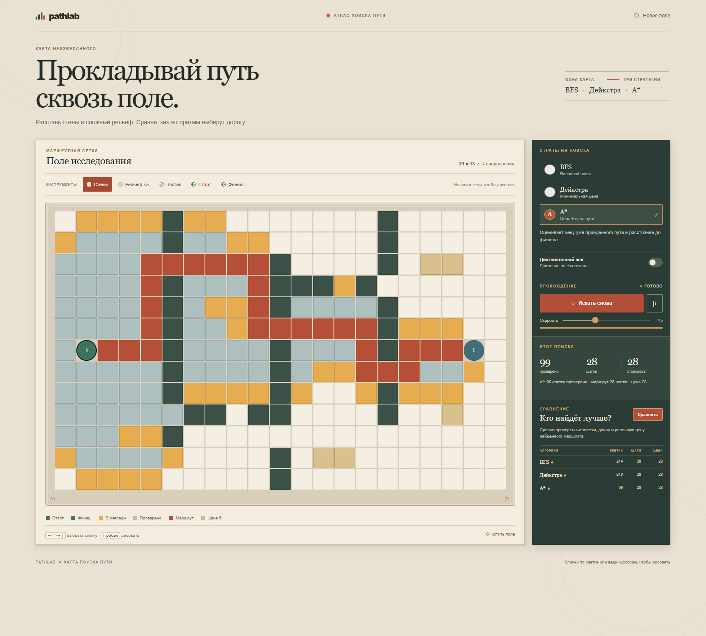

# PATHLAB

Interactive route atlas for exploring pathfinding algorithms on a hand-edited grid.

## Русский

PATHLAB превращает поиск пути в исследование карты. Меняйте ландшафт, запускайте алгоритм и наблюдайте, как он открывает клетки, выбирает направление и прокладывает дорогу.

### Возможности

- Сравнение BFS, Дейкстры и A* на одной карте.
- Рисование стен и дорогого рельефа, перемещение старта и финиша.
- Пошаговый или автоматический запуск с паузой и настройкой скорости.
- Переключение между движением по четырём и восьми направлениям.
- Сравнение числа проверенных клеток, длины и реальной стоимости каждого найденного маршрута.
- Управление с клавиатуры: стрелки выбирают клетку, пробел применяет выбранный инструмент, `Ctrl/Cmd + Z` отменяет последнее изменение.

### Запуск

Проект не требует сборки или установки зависимостей. Откройте `index.html` в браузере или разместите папку на любом статическом хостинге.

### Скриншот

## English

PATHLAB turns pathfinding into a map exploration. Shape the terrain, choose an algorithm, and watch it discover cells, weigh its options, and draw a route.

### Features

- Compare BFS, Dijkstra, and A* on the same map.
- Draw walls and costly terrain; move the start and finish markers.
- Run automatically or step through the search, pause, and adjust its speed.
- Switch between four-way and eight-way movement.
- Compare explored cells, route length, and the actual terrain cost of each route.
- Keyboard controls: arrow keys select a cell, Space applies the active tool, and `Ctrl/Cmd + Z` undoes the last edit.

### Run locally

No build step or dependencies are required. Open `index.html` in a browser or deploy the folder to any static host.

### Screenshot

## Design idea

The interface takes cues from a field atlas: warm chart paper, ink-dark instruments, survey marks, and route colors borrowed from cartography. This gives the grid a clear visual language while keeping the animated search at the center of the experience.

## Technologies

HTML, CSS, and vanilla JavaScript. The app runs entirely in the browser; it does not send the map to a server.
